# ShopSmart AI — Architecture & System Design Overview

> Derived from `PRD.md` v1.0.0 + `ShopSmartAI_Hackathon_Usecase.docx`.
> Stack constraint: **React 19 + Vite | Java + Spring Boot 3 + Spring AI | PostgreSQL + PgVector**
> Scope: **Hackathon MVP with production-grade architecture. Real payments, real carriers, real WMS are OUT OF SCOPE (simulated).**

---

## Part 1 — Project Summary

### 1.1 Vision
Build **ShopSmart AI**, an autonomous, AI-first e-commerce assistant platform (Amazon-like core capabilities) that provides:

- Natural-language product discovery + explainable, grounded recommendations.
- Accurate policy/warranty/shipping/refund/membership answers from approved documents (RAG).
- Order tracking + shipment visibility.
- Safe, auditable agentic operations for support/fulfillment exceptions.

Not a generic chatbot — a **safe, grounded, explainable commerce platform**.

### 1.2 Problems Solved

| For Customers | For Ops Teams |
|---|---|
| Can't find right product among alternatives | No inventory visibility |
| Unclear delivery dates / shipping costs | Fulfillment exceptions are manual |
| Confusing return/refund/warranty/membership policies | Repeated policy questions = support overload |
| Inconsistent support across channels | No coordination between support / catalog / inventory / fulfillment |
| Slow order-issue resolution | AI decisions not auditable |

### 1.3 Product Goals (North-Star)

| Goal | Meaning |
|---|---|
| Grounded AI | No invented products, prices, specs, stock, or policies |
| Explainability | Every recommendation/answer traceable to source |
| Safe agents | Only explicitly authorized actions via tools |
| Reliability | Deterministic fallback when models/tools fail |
| Hackathon feasibility | E2E flow without real payments/logistics |
| Production readiness | Clean schema, validation, tests, audit, secure APIs |

Hackathon metrics: (1) AI-assisted discovery success rate, (2) Grounded policy answer rate with citations, (3) Simulated checkout completion rate, (4) Agent safety rate (no unauthorized action, all audited).

### 1.4 MVP Scope vs Out-of-Scope

**MVP Must-Have — Customer:**
Registration/login (JWT), catalog browse, category hierarchy, search/filter/sort/pagination, PDP, comparison (≤4), wishlist, cart, preferences, membership display, simulated checkout, order history/tracking, AI shopping assistant, RAG policy assistant.

**MVP Must-Have — AI:**
Constraint extraction/validation, catalog-grounded ranking, explainable responses, document ingestion/versioning, chunking/embeddings (PgVector), hybrid retrieval, grounded generation with citations/confidence, safe fallback, trace logging.

**MVP Must-Have — Ops:**
Admin catalog/inventory/orders/documents/tickets/audit/approvals, simulated order/shipment ops, human approval for sensitive simulated ops.

**Stretch:** coupons, multi-warehouse, personalized ranking/reorder, semantic catalog search, multi-channel consistency, recovery workflows, analytics, a11y/i18n.

**Explicitly Out-of-Scope:** real payment/money movement, real carrier APIs, real warehouse automation, seller onboarding, fraud detection, logistics optimization, multi-currency/tax, native mobile (responsive web is enough).

**Post-hackathon (don't block):** real payments/carriers/WMS, multi-region, Kafka streaming, fraud, seller flows, SOC2/PCI/GDPR hardening, LLM eval pipelines, multi-language, real notifications.

### 1.5 Key Assumptions (A1–A12)

JWT auth; tiers `BASIC/PRIME/PREMIUM`; seeded structured products; central inventory; warehouse via internal/simulated APIs; trusted versioned documents (`version, effectiveDate, category, region`); simulated payment/shipment; configurable/mockable models; English-only, single-region MVP.

### 1.6 Personas & Critical Journeys

**Customers:** Ananya (laptop for Java+AI), Rahul (delivery/returns clarity), Sneha (budget compare/wishlist), Vikram (premium SLA), Meera (plain-language help).
**Ops:** L1 Support, Ops Manager, Catalog Manager, Knowledge Admin, Finance Ops.

Three golden journeys (must demo):
1. **AI Discovery:** login → `Suggest laptop under $1000 for Java+AI` → extract budget/category/use-case → query real catalog → rank → explain (ID/name/reason/availability) → add to cart → checkout → track.
2. **RAG Policy:** `Can I return opened laptop?` → search ACTIVE latest docs → grounded answer + confidence + doc/section/version → fallback if no evidence.
3. **Fulfillment Exception:** shipment delayed → `Where is ORD-123?` → `order.get` + `shipment.track` → factual status → offer eligible cancel (approval if sensitive) → audit trail.

### 1.7 Tech Stack (Normative)

| Layer | Choice |
|---|---|
| Frontend | React 19 + Vite, responsive accessible components, React Query / Zustand |
| Backend | Java 21+, Spring Boot 3, Spring AI, Spring Data JPA, Jakarta Validation |
| DB | PostgreSQL 15+ + PgVector (single source of truth: relational + vectors + audit + outbox) |
| Auth | JWT (`sub, roles, iss, exp`, 15–30 min expiry) + RBAC server-side |
| Docs | OpenAPI 3, Flyway/Liquibase, Docker Compose |
| Tests | JUnit, Testcontainers, Playwright/Cypress optional, golden RAG datasets |
| AI | Configurable provider (`mock\|openai\|ollama\|other`), deterministic mock mode for demo |

Roles: `CUSTOMER, SUPPORT_AGENT, OPS_MANAGER, CATALOG_MANAGER, KNOWLEDGE_ADMIN, ADMIN, AGENT_RUNTIME`.

---

## Part 2 — System Design & Architecture

### 2.1 Architecture Style Decision

**Modular monolith** (PRD §4.2–4.3).

Why: easier hackathon run/test, fewer distributed failures, clean module boundaries, decomposable later. Async via Spring events + `outbox_events` table (Kafka-ready).

Key decisions:

| Decision | Rationale |
|---|---|
| Modular monolith | Coherence + low ops overhead |
| Postgres as SSOT | Integrity + vector search in one DB |
| AI must reference real records | Anti-hallucination |
| Tool-based agents only | Safe, explicit, auditable |
| Server-side validation everywhere | Never trust model/client output |
| Simulated externals behind interfaces | Swappable for real systems |
| Mock model adapters | Deterministic live demo |
| Outbox pattern | Future-proof async |

### 2.2 High-Level Architecture

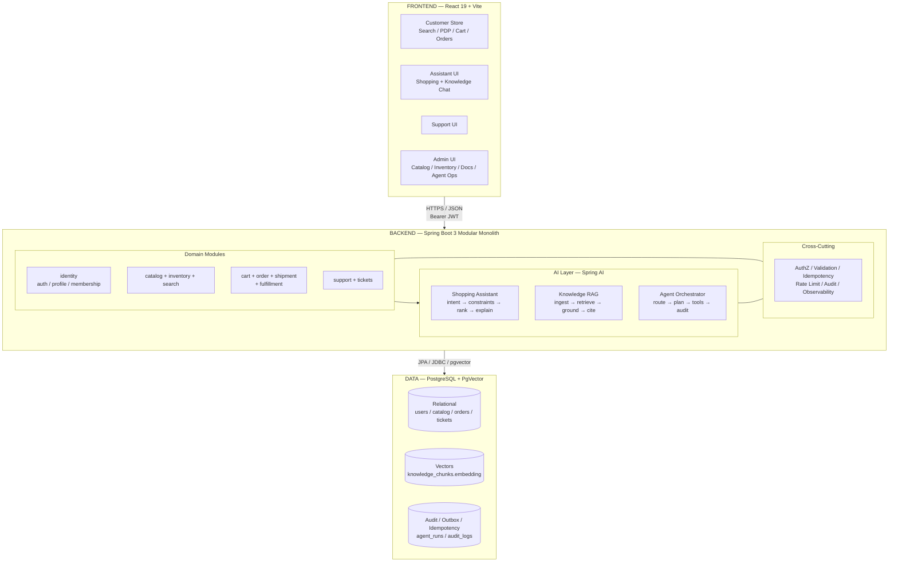

### 2.3 Module Boundaries

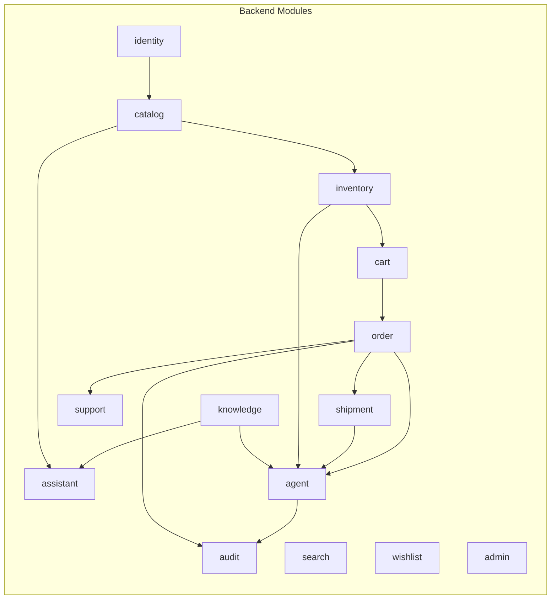

| Module | Responsibility |
|---|---|
| `identity` | Users, JWT, roles, preferences, membership |
| `catalog` | Categories, products, attributes, images |
| `inventory` | Stock, reservations, availability |
| `search` | Filter/sort/pagination/text search |
| `wishlist` | Saved items |
| `cart` | Items, validation, price re-check |
| `order` | Checkout + lifecycle |
| `shipment` | Lifecycle + simulated carrier events |
| `support` | Tickets, conversations, escalations |
| `knowledge` | Docs, chunks, embeddings, RAG |
| `assistant` | Shopping orchestration |
| `agent` | Tool execution workflows |
| `admin` | Internal actions |
| `audit` | AI + ops action logs |

### 2.4 Data Design (Simplified ER)

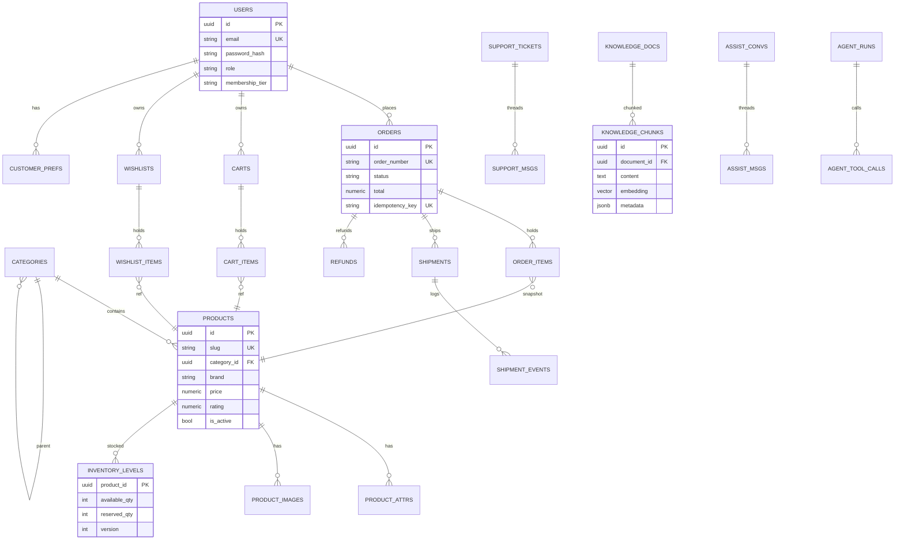

Core invariants:

- `inventory_levels.available_quantity >= 0`; checkout does `SELECT ... FOR UPDATE` (MVP) or optimistic `version` + retry; cancellation releases reservation; never oversell.
- Pricing: never trust client totals; server recalculates; order stores snapshot; post-checkout price changes don't mutate orders.
- RAG: only `status=ACTIVE` latest `effectiveDate` docs by default; `SUPERSEDED/ARCHIVED` excluded unless historical query; region/category filtered.
- AI grounding: shopping IDs/prices/stock must exist in DB; knowledge answers require citations or `NONE` fallback; agents can't claim success without tool success.

### 2.5 API Surface (`/api/v1`, JSON, RFC7807 errors, `Idempotency-Key`)

| Area | Endpoints |
|---|---|
| Auth | `POST /auth/register`, `POST /auth/login` |
| Catalog | `GET /categories`, `GET /products/search?...`, `GET /products/{id}`, `GET /products/compare?ids=` |
| Wishlist/Cart | `GET/POST/DELETE /wishlist...`, `GET /cart`, `POST/PUT/DELETE /cart/items...` |
| Orders | `POST /orders` (idempotent), `GET /orders`, `GET /orders/{id}`, `POST /orders/{id}/cancel` |
| Shipment | `GET /orders/{id}/shipment` |
| AI | `POST /assistant/shopping/query`, `POST /assistant/knowledge/query`, `POST /assistant/ops/query`, `POST /agent/actions/execute` |
| Admin | `POST /admin/knowledge/documents` (multipart), `POST .../activate`, `POST /admin/inventory/{id}/adjust` |

Standard error:
```json
{"type":"https://shopsmart.ai/errors/validation","title":"Invalid request","status":400,"detail":"budget must be > 0","instance":"/api/v1/assistant/shopping/query","traceId":"trace_123"}
```

### 2.6 Events (Outbox → future Kafka)

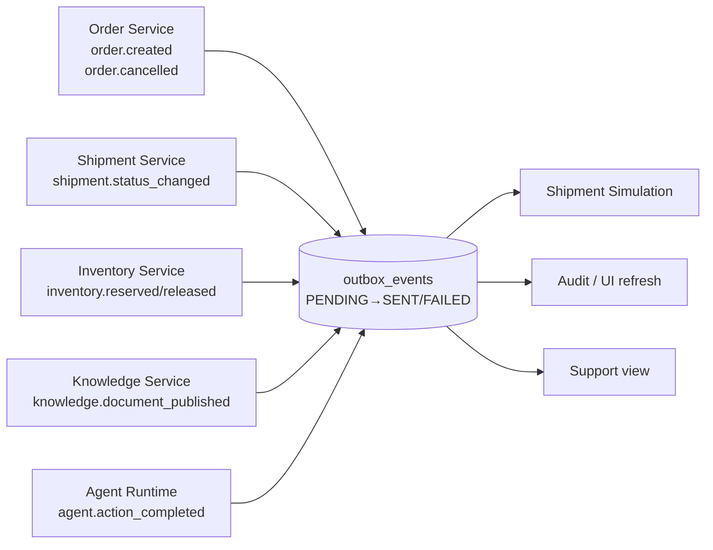

### 2.7 Cross-Cutting: Security, Observability, Reliability

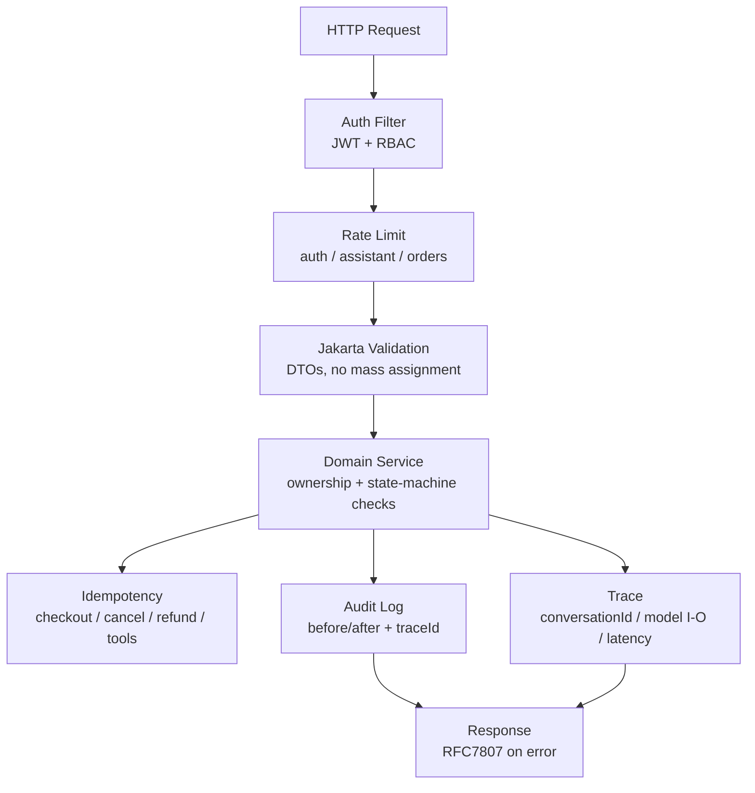

- Auth: bcrypt/argon2, no secrets in logs, CORS locked to FE origin, secure headers, ownership checks (customers see own orders only).
- AI safety: prompt-injection guard, output schema validation, tool allowlist, human approval for refunds > threshold / doc publish / inventory adjust / pricing changes, citation enforcement, `NO_EVIDENCE` fallback, no direct DB mutation by model, post-validation before UI.
- Observability: logs with `traceId` (API/AI/tools/approvals, no passwords/tokens/PII); metrics (latency, error rate, orders created/cancelled, stockouts, model timeout/malformed rate, RAG hit/no-evidence/confidence, agent tool/approval/escalation rates); AI traces (query, sanitized query, product IDs/chunks, raw + validated output, latency, error).
- Reliability: idempotency everywhere mutating; transactional checkout+inventory; graceful AI fallback; never silently succeed; explicit failure > fabricated answer.

### 2.8 Deployment (Local MVP)

```mermaid
flowchart LR
    DEV[Dev Machine] --> DC[Docker Compose<br/>postgres:15 + pgvector]
    DEV --> BE_RUN[Backend<br/>./mvnw spring-boot:run :8080]
    DEV --> FE_RUN[Frontend<br/>npm run dev :5173]
    BE_RUN --> DC
    FE_RUN -- VITE_API_BASE_URL<br/>http://localhost:8080/api/v1 --> BE_RUN
    ENV[env: SPRING_DATASOURCE_URL<br/>AI_PROVIDER=mock|openai|ollama<br/>EMBEDDING_PROVIDER<br/>JWT_SECRET] -.-> BE_RUN
```

Seed: 3 categories, 20+ products (5 laptops/5 phones/5 appliances/5 accessories), 3 users + support/admin, 3+ policy docs, 2 orders, 1 shipment. `AI_PROVIDER=mock` → deterministic vectors/extraction for demo.

---

## Part 3 — Workflow Overview (End-to-End Flows)

### 3.1 Master Customer Journey

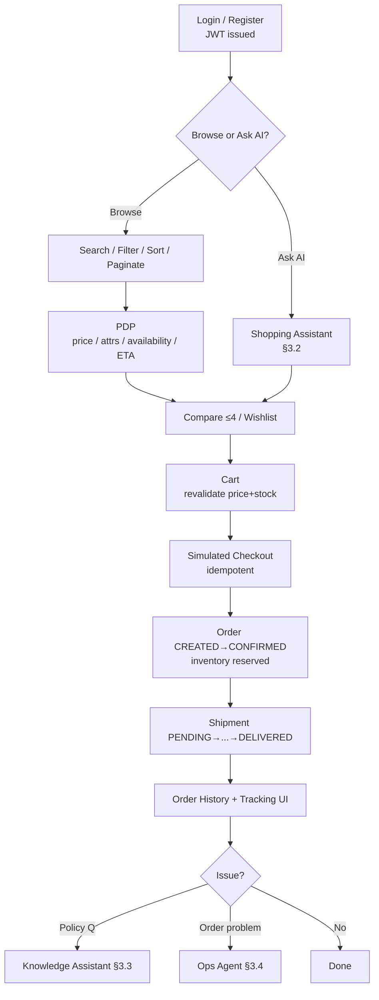

### 3.2 Workflow A — AI Shopping Assistant Pipeline

PRD §6.3 pipeline; deterministic weighted ranking (budget 30%, attribute/use-case 30%, rating 20%, availability 10%, preference 10%; preferences never override hard constraints).

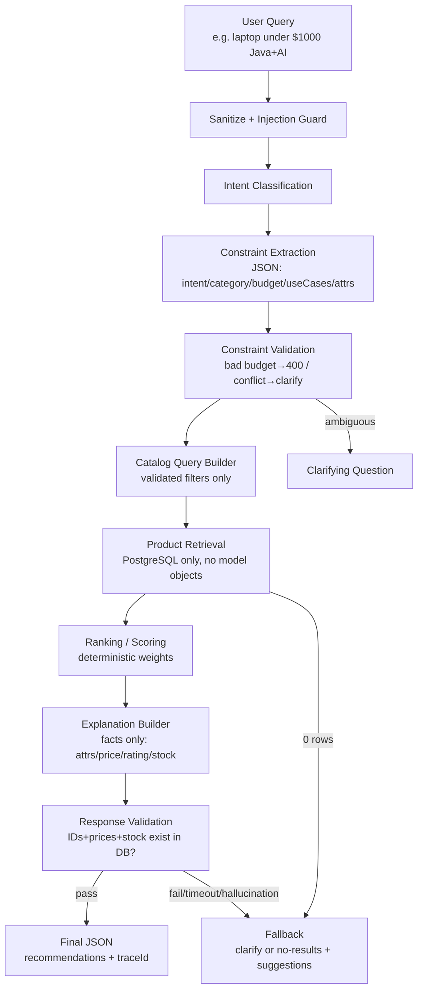

Example constraint JSON → catalog filter → response contract in PRD §6.4/§6.9. Anti-hallucination: discard any product object not in DB; never claim purchase without order API result; forbid `best-in-class/guaranteed` style claims.

### 3.3 Workflow B — RAG Knowledge Assistant (Ingest + Answer)

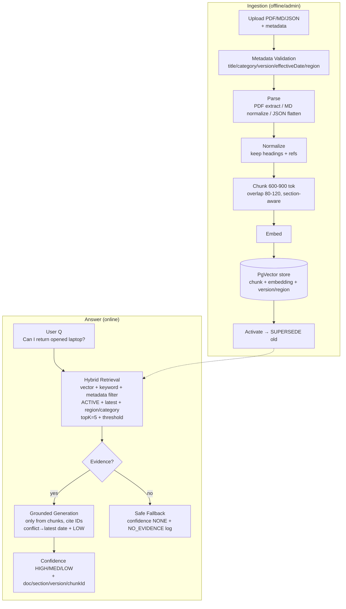

Confidence policy: HIGH → answer; MEDIUM → answer with caveat; LOW → cautious + escalation suggestion; NONE → `I don't have enough approved information...` + `followUpRequired:true`. Same service backs customer chat + support console for consistency.

### 3.4 Workflow C — Agentic Operations (Orchestrator + Tools)

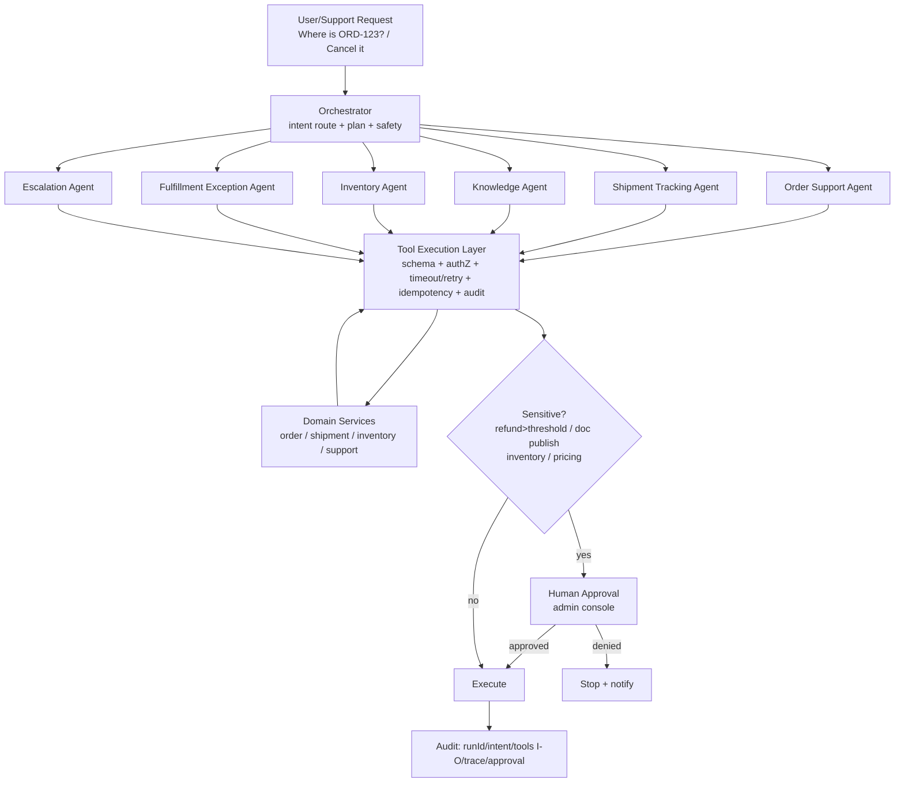

MVP tools: `customer.get_profile, order.get, order.list_by_customer, shipment.track, inventory.check, order.cancel_simulated, refund.create_simulated, support.ticket.create, support.escalate, fulfillment.flag_exception, catalog.search_alternatives` — each with name/desc/role/JSON I-O schema/timeout/retry/error taxonomy. Timeouts: reads 2s+2 retries, writes 5s+1 retry if idempotent, models 10s+1, embeddings 5s+1. Agent never touches DB directly; output post-validated.

Sequence — tracking + cancel:

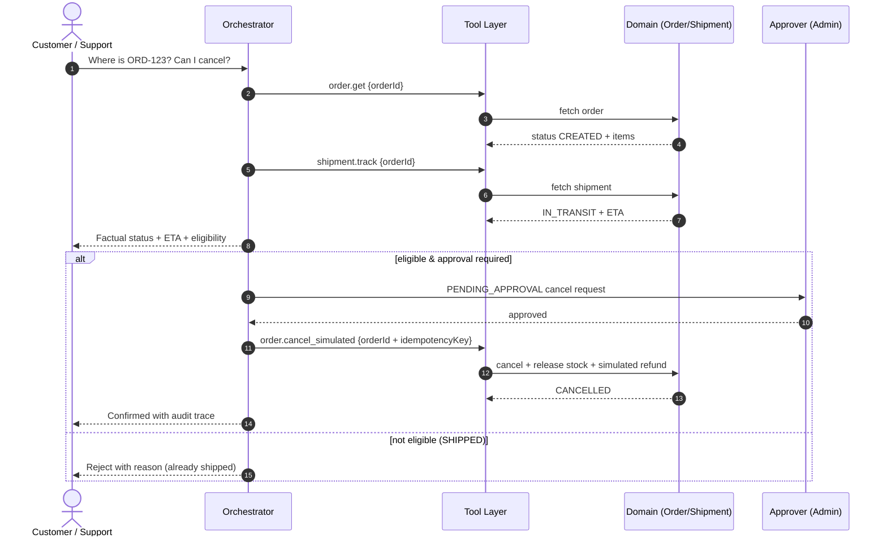

### 3.5 Workflow D — Simulated Checkout → Fulfillment (Happy + Failure)

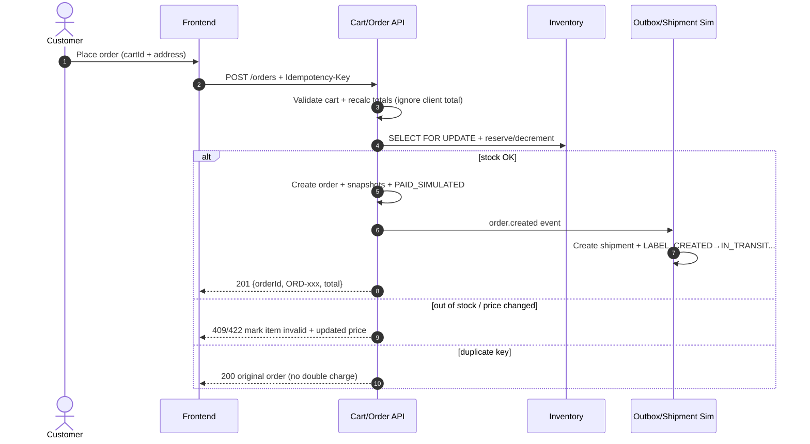

State machines:

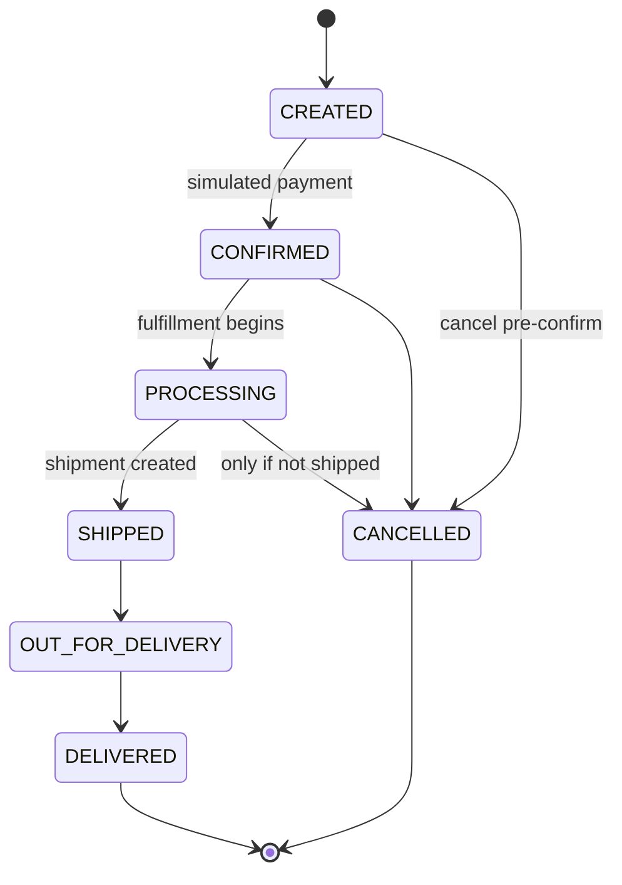

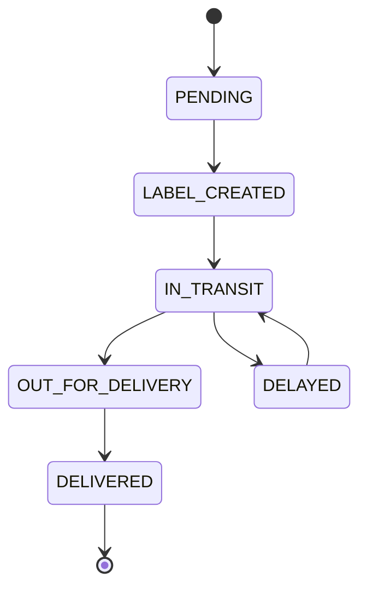

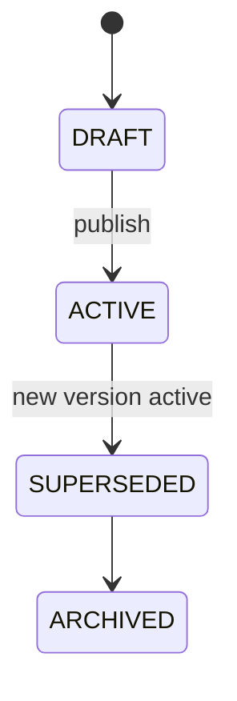

Cart: `ACTIVE → CHECKED_OUT | ABANDONED`. Refund (simulated): `REQUESTED → APPROVED → COMPLETED`, idempotent, `amount ≤ paid`.

### 3.6 Failure & Recovery Map (PRD §15, 54 cases compressed)

| Domain | Detect → Recover |
|---|---|
| Search | invalid filters → 400; 0 rows → empty state + assistant prompt; disabled-in-cart → mark invalid |
| Checkout | OOS → 409 + fix cart; price change → show server price; duplicate → return original; concurrent oversell → lock/version rejects late txn; shipment-sim fail → retry, order stays valid |
| Order/shipment | inconsistent state → reconcile via state machine; dup shipment → return existing; cancel-after-ship → reject; dup cancel/refund → idempotency |
| AI | timeout/malformed/hallucinated product/missing citation → retry once → fallback; contradiction → LOW + admin queue; embedding down → disable RAG gracefully; injection → sanitize + ignore |
| Agent/tools | timeout/malformed/unauthorized/partial → block + audit + escalate; approval denied → stop + notify; success claimed without tool success → block |
| Security | expired JWT → 401; wrong role/owner → 403/404; replayed mutation → idempotent replay |

Principles: never silently succeed; explicit failure > fabrication; human escalation for ambiguity; full trace for every AI/agent action.

### 3.7 UI Map → Workflows

Customer: Home (search + category chips + AI entry) → Results (filters/sort/cards/pagination) → PDP (gallery/attrs/availability/ETA/cart/wishlist/compare) → Compare (≤4 side-by-side) → Wishlist → Cart (qty/validation/warnings) → Checkout (address + simulated pay + idempotent submit) → History/Detail (status badge, timeline, cancel-if-eligible, support) → Assistant panels (shopping cards + reasons + add-to-cart; knowledge answer + confidence + citations).
Admin/Ops: catalog CRUD + attributes/images, inventory adjust + reservations, order search/detail/cancel/refund/flag, doc upload/metadata/chunk preview/activate/contradiction review, agent runs/tool inspector/approval queue.
Support console reuses same RAG service + order context + recommended actions + escalate.

### 3.8 NFRs, Tests, Roadmap, Demos

**NFR targets:** search p95 <500ms, PDP/cart <300ms, order <1s, shopping AI <5s, knowledge <7s, initial load <3s; indexes on filter cols + HNSW/IVFFlat on embeddings; pagination everywhere; no N+1; DTOs ≠ entities; centralized errors; WCAG basics (keyboard, focus, labels, contrast).

**Tests:** unit (services/validators/state machines) → integration (API+DB+AI mocks) → E2E (register→search→cart→checkout→track; assistant grounded; RAG cited; agent approval/idempotency) → golden RAG sets (20 policy + 5 manual + 5 no-answer + 3 contradiction + 3 outdated). Sign-off = 15 PRD §20.4 criteria (auth, search, compare, wishlist/cart, checkout, tracking, both assistants, missing-evidence fallback, agent lookup + 1 audited mutation, admin CRUD, authZ, tests, setup).

**Roadmap:** P1 MVP (above) → P2 stretch (coupons, personalization, semantic search, multi-warehouse, richer recovery, embedded support chat, analytics) → P3 production (real payments/carriers/WMS, Kafka, multi-region, eval pipelines, compliance, notifications, sellers).

**Live demos (5):** (1) laptop query → recommend → cart → order; (2) opened-laptop return → cited answer → unsupported Q → fallback; (3) `Where is ORD-123? Can I cancel?` → timeline + eligibility; (4) admin price edit + restock + audit + doc versioning; (5) malformed-model fallback + duplicate checkout + blocked unauthorized action.

---

## Appendix — File / Repo Map (Proposed)

```text
shopsmart-ai/
  backend/  src/main/java/... (identity|catalog|inventory|search|cart|order|shipment|support|knowledge|assistant|agent|admin|audit)
            src/main/resources/ (migrations, prompts, seeds)
  frontend/ src/ (store|assistant|support|admin|api client)
  docker-compose.yml   seed/   docs/ (this file + OpenAPI)
```

**Definition of done:** working FE+BE, seeded DB, this diagram doc, setup instructions, live demo of both assistants + tracking + 1 safe agent action, proper schema/validation/errors, clean structure, tests/plan, simulated-vs-real statement.

*Source: PRD §§1–24 + hackathon use-case doc. Simulated = `PAID_SIMULATED`, `SIM-TRACK-*`, mock carrier/WMS; production swap behind interfaces.*
